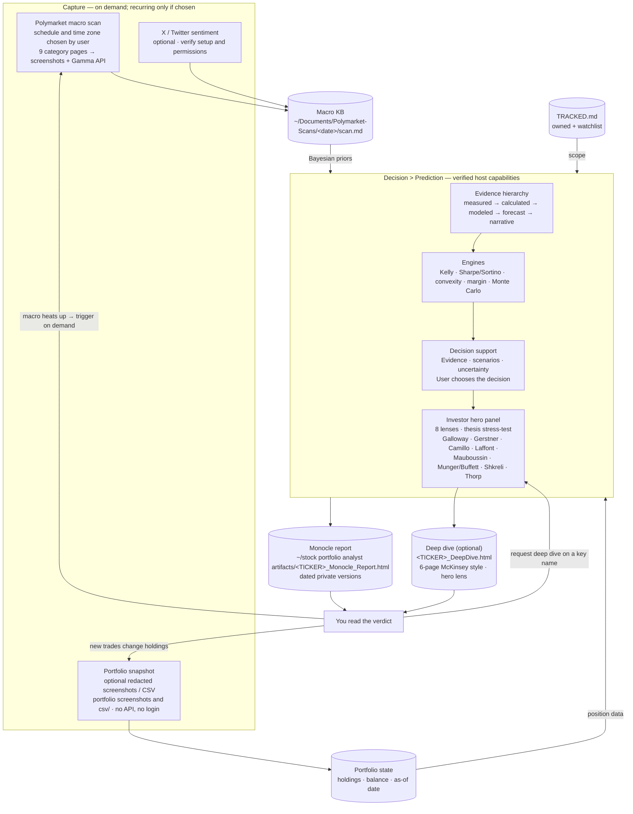

# START HERE — Hermes Thrice Great · Decision > Prediction

## Educational use and privacy

Decision ≥ Prediction is educational research and decision support. It presents evidence, exposure, assumptions and scenarios so users make their own decisions and predictions. It does not provide portfolio advisory, prescribe trades or allocations, or issue Buy/Hold/Add/Trim/Sell instructions. Older engine/schema names containing “recommendation” describe model artifacts, not personal advice; the dot reporting flow must not present them as recommended actions.

For optional portfolio context, recommend a redacted CSV or screenshot with names, account numbers and other identifiers removed before sharing. Keep only necessary holdings/exposure fields and the as-of date; verify extracted values. The project creator is not an intended recipient of inputs or outputs. The selected agent, model, storage or hosting provider may process or retain data under its own policies. Verify the actual workflow and destination; this documentation does not guarantee that all deployments are local-only or that a creator can never receive data. Do not upload private data to GitHub, public hosting or a new provider without required permission.

## First report with OAI Dot

Start with one ticker and a public-data-only [first report](docs/reports/FIRST-REPORT-WITH-DOT.md). The reusable [HTML template](templates/stock-report/Stock-Report-Web-Template.html) and [authoring guide](docs/reports/HTML-REPORT-GUIDE.md) provide the editorial report, eight investor lenses plus Page, Business Model Canvas, Seven Powers and final generated sketchnote. This is an authoring scaffold, not a completed report or installed automation; browser and new-user acceptance remain unverified.

## Platform onboarding and verified scope

For first-use setup with dot, Meta Muse AI, Grok Bot, Claude Cloud or Hermes, read the [platform onboarding guides](docs/platforms/README.md) and [customer setup manual](docs/Decision-Prediction-onboard-setup.md). These explain available investor-inspired lenses, separate analysis and risk preferences, evidence gates, verified versus conditional capabilities, and opt-in review schedules.

The guides are source documentation, not a native integration or installer. The current staging allowlist excludes these guides and the eight original investor cards; automatic installed-profile discovery needs separate implementation and tests. See the [full-report completeness gate](docs/Decision-Prediction-onboard-setup.md#full-report-completeness-gate) before claiming the whole workflow was applied.

The operational guide for the investment-reasoning system: a Hermes agent that applies Edward Thorp-style evidence discipline to a concentrated barbell portfolio (AI · defense · minerals & energy · fintech).

The documented reporting flow uses optional user-supplied, redacted portfolio screenshots/CSVs rather than brokerage login. Files can remain in the selected private workspace, but the chosen host or model provider may process them; inspect permissions and data flow before use. File placement alone is not a complete security model.

## The loop

Three capture rhythms feed one analysis core, which produces two artifact types, and your decisions close the loop.

## What YOU do manually

1. **Optionally provide redacted portfolio context** in the selected private workspace: CSV or screenshots with names, account numbers and identifiers removed. Newest wins; CSV beats screenshots. Everything is labeled as-of the snapshot date — data may be stale; that is expected and disclosed.
2. **Confirm values when asked** — a value only becomes `measured` after you verify it.
3. **(Optional) X sentiment:** install `xurl` and complete OAuth (`xurl auth oauth2`) outside the agent. Until then the X step is skipped gracefully.
4. **Keep `TRACKED.md` current** — PORTFOLIO (owned) + WATCHLIST (eyeing). This drives what gets refreshed.
5. **Ask in chat:** "analyze GOOG", "update my portfolio", "deep dive NVDA", "run the macro scan".

## Optional automation patterns (not enabled by this guide)

- **Polymarket macro scan** (example configuration): timing and recency guards depend on the selected host and explicit user schedule. No live cron or successful scheduled run is established for a new user.
- **Artifact refresh** (optional): agree tickers, timing and time zone, then verify the host schedule and delivery.
- **On-demand:** macro scan when things heat up; deep dives any time.

## Artifacts

- `~/stock portfolio analyst artifacts/<TICKER>_Monocle_Report.html` — standard report (13 sections: position, frameworks, Bayesian, Sharpe/Kelly, engines, convexity, simulation, margin, options, barbell, investor heroes, metrology, verdict).
- `~/stock portfolio analyst artifacts/<TICKER>_DeepDive.html` — optional 6-page McKinsey-style investor deep dive from the investor-hero lens.
- Both use the same DESIGN-*.md system (Monocle / Creative Giants / Ease Health) and use a stable report identity with dated private version history for the enhanced reading edition.

## Evidence & engines

- Evidence hierarchy (non-negotiable): **measured > calculated > modeled > forecast > narrative > unknown**. Every number is labeled.
- Engines (`plugins/capital-decision-lab`, deterministic Python): Kelly sizing (fractional + capped), Sharpe/Sortino/Calmar, convexity, margin safety, seeded Monte Carlo.
- Reporting conclusion: evidence, scenarios, uncertainty and conditions that would change the analysis. No Buy/Hold/Trim/Add/Sell advice or prescribed allocations; the user makes the decision.

## Repo layout

- `skills/` — Hermes skills: `decision-prediction` (process), `capital-research`, `polymarket-macro-scan`, `stock-portfolio-artifacts`.
- `design/` — DESIGN-*.md style references (Monocle, Creative Giants, Ease Health).
- `docs/` — architecture, evidence, finance-math specs, workflows, safety boundaries.
- `plugins/capital-decision-lab/` — the calculation engines.
- `schemas/`, `fixtures/`, `tests/` — contracts, test data, verification.

## First-time checklist (duration depends on verified capabilities)

1. Clone this repo; open it as the Hermes working directory.
2. Create `~/stock portfolio analyst artifacts/` and its `portfolio screenshots and csv/` subfolder (see the `stock-portfolio-artifacts` skill).
3. Start with one ticker and public data. Optionally add a redacted portfolio screenshot or CSV later.
4. In chat: "research <TICKER> with public data using the HTML report guide".
5. Verify the values quoted — they become `measured` only after your confirmation.
6. Optional: install `xurl` for X sentiment; ask for the Sunday refresh cron once comfortable.

